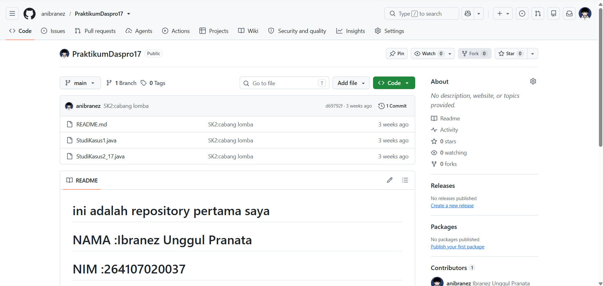

# JOBSHEET 6 - STUDI KASUS PEMILIHAN DENGAN GIT DAN GITHUB

**Identitas Mahasiswa:**
* **Nama:** [Ibranez Unggul Pranata]
* **NIM:** [264107020037]
* **Kelas / No. Presensi:** [1D / 17]

---

## 1: TUJUAN PRAKTIKUM

Berikut adalah tujuan pelaksanaan praktikum pada bab ini:

1. Mahasiswa mampu menyelesaikan studi kasus menggunakan struktur pemilihan dasar dan pemilihan bersarang
2. Mahasiswa mampu menyimpan dan mengumpulkan pekerjaan menggunakan Git dan GitHub melalui Visual Studio Code
3. Mahasiswa mampu berkolaborasi dengan teman menggunakan GitHub

---

## 2: HASIL PERCOBAAN & ANALISIS

### 2.1 Instalasi Git dan Konfigurasi Identitas




---

### 2.3 Percobaan 2: Studi Kasus 1 – Pemilihan Dasar

Kedai Kopi Senja menjual Kopi Susu Gula Aren seharga Rp18.000 per cup dan memberikan diskon 10% untuk pembelian minimal Rp100.000. Program kasir menghitung total harga, diskon, total bayar, dan kembalian (atau kekurangan uang) berdasarkan flowchart pada jobsheet.

#### 2.3.1 Kode Program Java
```java
// File: StudiKasus1.java
import java.util.Scanner;
public class StudiKasus1 {
    public static void main(String[] args) {
        Scanner sc = new Scanner(System.in);
        int hargaPerCup = 18000;
        int jumlahCup,uangBayar,totalHarga,diskon,totalBayar,kembalian,kurang;

        System.out.print("Masukkan jumlah cup yang dibeli: ");
        jumlahCup = sc.nextInt();
        System.out.print("Masukkan uang yang dibayarkan: ");
        uangBayar = sc.nextInt();
        totalHarga = hargaPerCup * jumlahCup;
        diskon = 0;

        if (totalHarga >= 100000) {
            diskon = totalHarga * 10 / 100;
            totalBayar = totalHarga - diskon;
            System.out.println("Total harga: " + totalHarga);
            System.out.println("Diskon: " + diskon);
            System.out.println("Total bayar: " + totalBayar);
            if (uangBayar >= totalBayar) {
                kembalian = uangBayar - totalBayar;
                System.out.println("Kembalian: " + kembalian);
            } else {
                kurang = totalBayar - uangBayar;
                System.out.println("Uang yang dibayarkan kurang sebesar: " + kurang);
            }
        } else {
            totalBayar = totalHarga;
            System.out.println("Total harga: " + totalHarga);
            System.out.println("Diskon: " + diskon);
            System.out.println("Total bayar: " + totalBayar);
            if (uangBayar >= totalBayar) {
                kembalian = uangBayar - totalBayar;
                System.out.println("Kembalian: " + kembalian);
            } else {
                kurang = totalBayar - uangBayar;
                System.out.println("Uang yang dibayarkan kurang sebesar: " + kurang);
            }
        }
    }
}
```

#### 2.3.2 Hasil Running / Screenshot Output

Masukkan jumlah cup yang dibeli: 3
Masukkan uang yang dibayarkan: 50000 
Total harga: 54000
Diskon: 0
Total bayar: 54000
Uang yang dibayarkan kurang sebesar: 4000

#### 2.3.3 Analisis
* Percobaan ini memakai dua struktur pemilihan terpisah. `if (totalHarga >= 100000)` menentukan diskon (jika tidak terpenuhi, diskon tetap 0). `if-else` kedua menentukan apakah uang cukup atau kurang.
* Variabel `diskon` diinisialisasi 0 sebelum `if`, sehingga `totalBayar = totalHarga - diskon` tetap benar saat tidak ada diskon.
* Pada pembelian 5 cup (Rp90.000), diskon tidak berlaku karena total harga belum mencapai Rp100.000.

---

### 2.4 Percobaan 3: Studi Kasus 2 – Pemilihan Bersarang

Program membantu Admin Kemahasiswaan mengecek status dana penghargaan prestasi mahasiswa. Aturannya:
* Perlombaan **BELMAWA/BAKORMA/Mandiri**: dana hanya untuk **Juara 1, 2, atau 3**.
* **PKM**: dana untuk tim yang **lolos pendanaan**.
* **Lainnya**: tidak memperoleh dana.
* Untuk kasus yang berhak, wajib mengupload **4 dokumen**. Jika kurang, dana tidak diberikan dan ditampilkan jumlah dokumen yang kurang.

#### 2.4.1 Kode Program Java
```java
// File: StudiKasus2_17.java

import java.util.Scanner;
public class StudiKasus2_17 {
    public static void main(String[] args) {
        Scanner sc = new Scanner(System.in);

        String nama,jenisKegiatan,statusDokumen,statusDana;
        int jumlahDokumen,peringkatJuara,pendanaanPkm;

        System.out.print("Nama Mahasiswa: ");
        nama = sc.nextLine();
        System.out.print("Jenis Kegiatan: ");
        jenisKegiatan = sc.nextLine();
        

        if(jenisKegiatan.equalsIgnoreCase("belmawa")||
           jenisKegiatan.equalsIgnoreCase("bakorma")||
            jenisKegiatan.equalsIgnoreCase("mandiri")) {
                System.out.print("Jumlah Dokumen: ");
                jumlahDokumen = sc.nextInt();
                System.out.print("Peringkat Juara: ");
                peringkatJuara = sc.nextInt();
                if (jumlahDokumen == 4) {
                    statusDokumen = "Dokumen lengkap";
                    statusDana = "Dana peghargaan diberikan";
                    if (peringkatJuara >= 1 && peringkatJuara <= 3) {
                        statusDokumen = "Dokumen lengkap";
                        statusDana = "Dana peghargaan diberikan";
                    } else {
                        statusDokumen = "Dokumen lengkap";
                        statusDana = "Dana peghargaan tidak diberikan";
                    }
                } else {
                    statusDokumen = "Dokumen tidak lengkap";
                    statusDana = "Dana peghargaan tidak diberikan";
                }
                System.out.println("Status: " + statusDokumen + " . " + statusDana);

            } else if (jenisKegiatan.equalsIgnoreCase("pkm")) {
                System.out.print("Jumlah Dokumen: ");
                jumlahDokumen = sc.nextInt();
                System.out.print("Peringkat Juara: ");
                peringkatJuara = sc.nextInt();
                System.out.println("Status Pendanaan PKM: ");
                pendanaanPkm = sc.nextInt();
        
                if (jumlahDokumen == 4) {
                    statusDokumen = "Dokumen lengkap";
                     if (pendanaanPkm == 1) {
                            System.out.print("Lolos pendanaan pkm");

                        }else {
                            System.out.print("Tidak lolos pendanaan pkm");
                        }
                } else {
                    statusDokumen = "Dokumen tidak lengkap";
                }
            } else {
                System.out.println("Tidak memperoleh penghargaan");
            
            
        
        }
    }
}

```

#### 2.4.2 Hasil Running / Screenshot Output

| No | Jenis | Dokumen | Peringkat / Pendanaan | Output |
|----|-------|---------|----------------------|--------|
| 1 | bakorma | 3 | Juara 1 | Dokumen tidak lengkap (kurang 1 dokumen). Dana penghargaan tidak diberikan. |
| 2 | Mandiri | 4 | 0 | Tidak memperoleh dana penghargaan (hanya untuk Juara 1, 2, atau 3). |
| 3 | pkm | 4 | 1 (lolos) | Berhak memperoleh dana penghargaan (PKM lolos pendanaan). |
| 4 | Lainnya | 4 | (tidak ditanyakan) | Tidak memperoleh dana penghargaan (jenis kegiatan tidak termasuk ketentuan). |


#### 2.4.3 Riwayat Commit Git
1. Commit pertama: `SK2: cabang lomba`
2. Commit kedua: `SK2: cabang PKM dan lainnya`
3. **Push** ke GitHub setelah kode selesai.


#### 2.4.4 Analisis
* Kedalaman *nested if* maksimal 3 tingkat: jenis kegiatan → peringkat/status pendanaan → kelengkapan dokumen.
* `equalsIgnoreCase()` dipakai agar huruf besar/kecil tidak berpengaruh pada jenis kegiatan.
* Program hanya menanyakan data yang diperlukan. Peringkat juara hanya ditanyakan pada cabang lomba, status pendanaan hanya pada PKM, dan cabang Lainnya tidak menanyakan data tambahan.
* Jumlah dokumen yang kurang dihitung dengan `4 - dokumen`.

---

### 2.5 Percobaan 4: Uji Silang Program Teman

Percobaan ini dikerjakan berpasangan. Saya menguji program `StudiKasus217.java` milik teman, dan teman menguji program saya.

#### 2.5.1 Langkah Percobaan
1. **Pemilik repository**: **Settings → Collaborators → Add people**, mengetik username GitHub teman, lalu **Add to repository**.
2. **Yang diundang**: membuka email undangan GitHub dan klik **Accept invitation**.
3. **Yang diundang**: menyalin URL repository teman (tab HTTPS) lalu *clone* melalui VS Code.
4. **Yang diundang**: menjalankan `StudiKasus217.java` dengan minimal 3 data uji, menuliskan hasilnya di bagian bawah `README.md`, lalu **Commit & Push** dengan pesan `Hasil uji SK2 oleh <Nama>`.
5. **Pemilik repository**: melakukan **Pull** (atau **Sync Changes**) dan memastikan hasil uji teman muncul di `README.md`.
6. **Pemilik repository**: membuka GitHub → **Commits** untuk memastikan commit teman tercatat.

#### 2.5.2 Hasil Uji pada README.md
```markdown
Hasil Uji Studi Kasus 2 oleh [Nama Teman]
| No | Jenis   | Dokumen | Juara/Dana | Output                                 | Sesuai? |
|----|---------|---------|------------|----------------------------------------|---------|
| 1  | BAKORMA | 3       | Juara 1    | Dokumen tidak lengkap (kurang 1)       | Ya      |
| 2  | Mandiri | 4       | 0          | Tidak memperoleh dana                  | Ya      |
| 3  | pkm     | 4       | 1          | Berhak memperoleh dana                 | Ya      |
| 4  | Lainnya | 4       | -          | Tidak memperoleh dana                  | Ya      |
```


#### 2.5.3 Analisis
* Kolaborasi melalui GitHub memungkinkan orang lain mengubah repository setelah menjadi *collaborator*.
* **Pull** wajib dilakukan sebelum mengubah file yang sama (misalnya `README.md`) agar tidak terjadi konflik.
* Semua hasil uji sesuai dengan keluaran yang diharapkan, sehingga tidak diperlukan perbaikan program.

#### Ringkasan Tombol Git di VS Code

| Proses Git | Fungsi | Tombol di VS Code |
|------------|--------|-------------------|
| Clone | Menduplikasi repository GitHub ke komputer | Welcome → Clone Git Repository → paste URL |
| Add (Stage) | Memilih perubahan yang akan di-commit | Source Control → ikon **+** |
| Commit | Menyimpan versi baru di local repository | Isi Commit Message → **Commit** |
| Push | Mengirim commit dari lokal ke GitHub | **... → Push** |
| Pull | Mengambil versi terbaru dari GitHub | **... → Pull** |
| Sync | Pull lalu Push sekaligus | **Sync Changes** |
| Discard | Membatalkan perubahan yang belum di-commit | Ikon **Discard Changes** |

---

## 3: KESIMPULAN

Berdasarkan praktikum yang telah dilakukan, Git dan GitHub dapat digunakan untuk menyimpan, melacak versi, dan mengumpulkan pekerjaan melalui alur *clone, add, commit, push, pull*. Studi kasus kasir menerapkan pemilihan dasar (`if` dan `if-else`) untuk menghitung diskon dan kembalian, sedangkan studi kasus dana penghargaan menerapkan pemilihan bersarang untuk memeriksa syarat secara bertahap dan menampilkan alasan hasilnya. Melalui uji silang, mahasiswa belajar berkolaborasi menggunakan fitur *collaborator*, *pull*, dan riwayat *commit* di GitHub.
